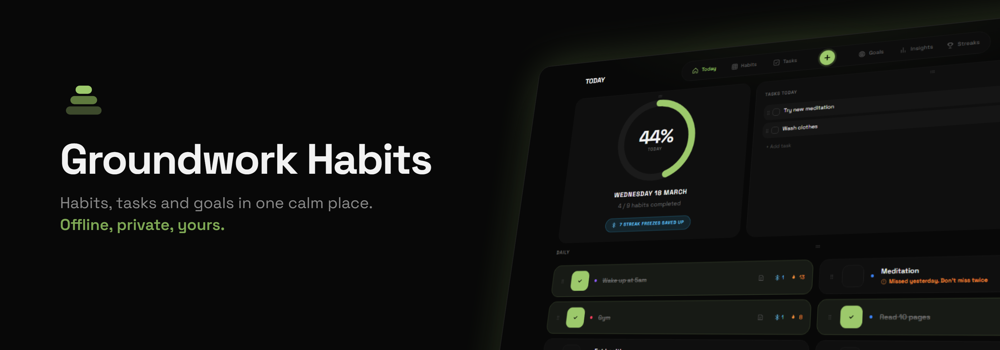
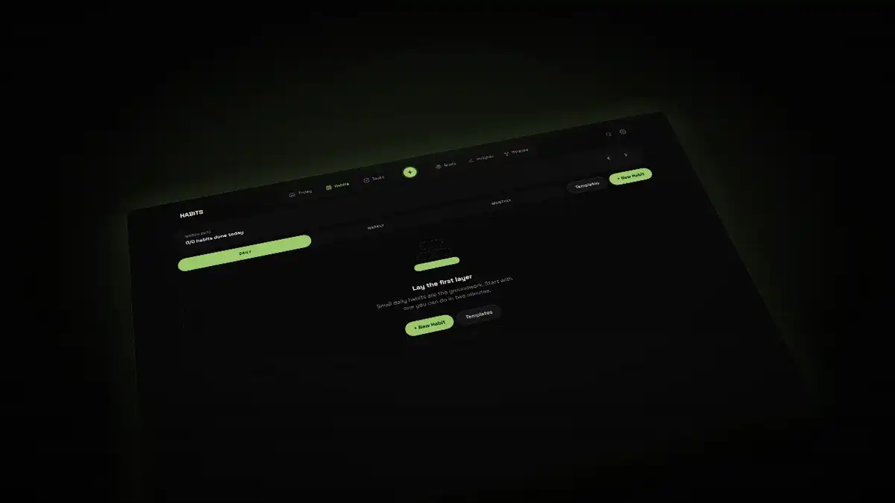
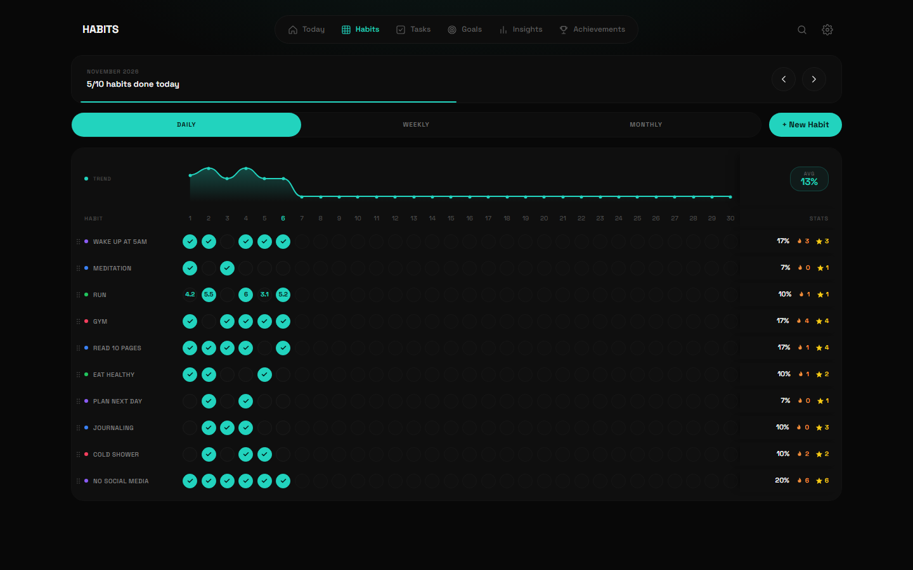
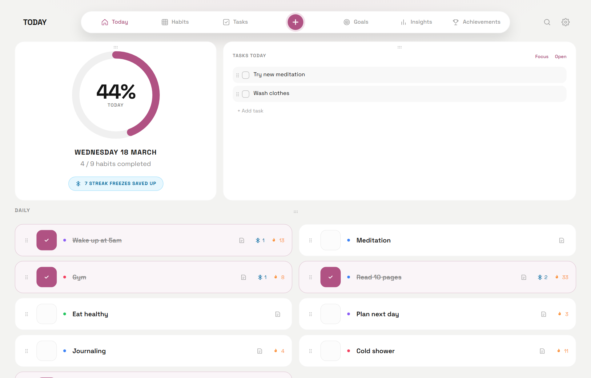
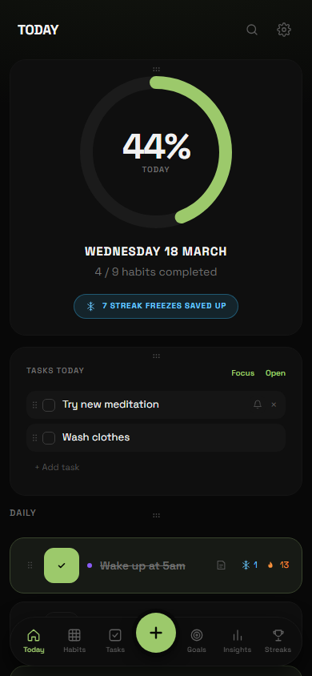
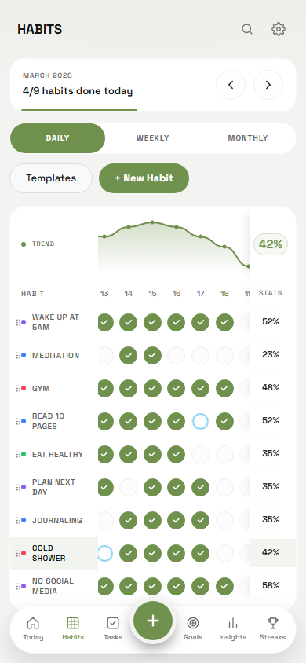
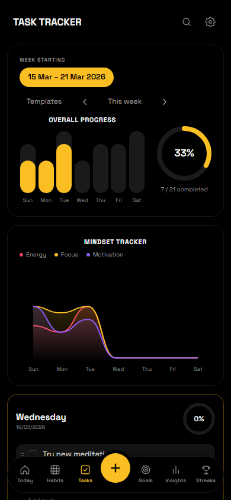
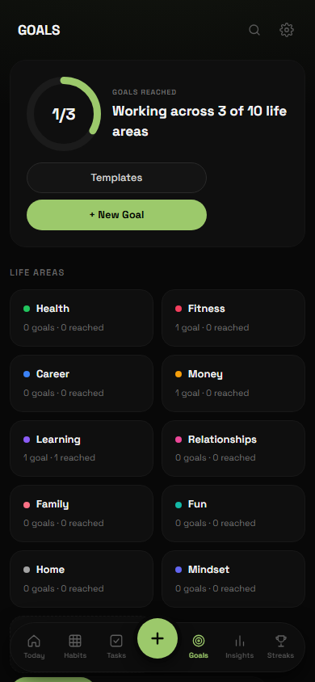
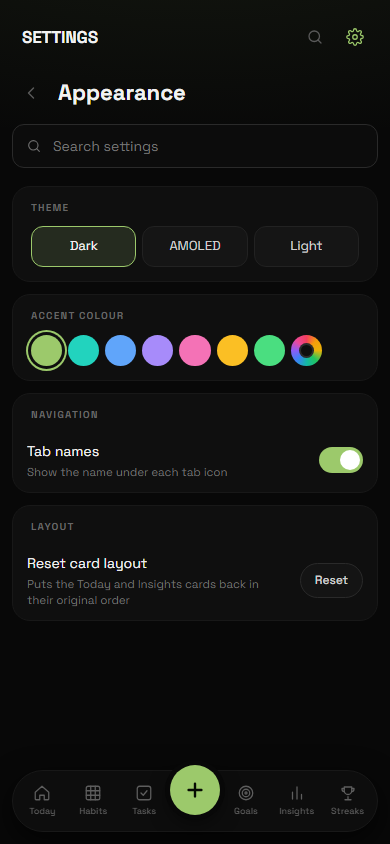
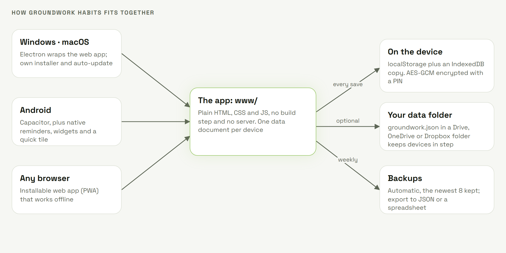

<div align="center">

<p>
<picture>
  <source media="(prefers-color-scheme: dark)" srcset="assets/readme/hero-dark.png">
  <source media="(prefers-color-scheme: light)" srcset="assets/readme/hero-light.png">
  
</picture>
</p>

<a href="https://github.com/English-Muffin/GroundworkHabits/stargazers"></a>
<a href="https://github.com/English-Muffin/GroundworkHabits/releases/latest"></a>
<a href="https://github.com/English-Muffin/GroundworkHabits/releases"></a>
<a href="https://github.com/English-Muffin/GroundworkHabits/actions/workflows/test.yml"></a>
<a href="LICENSE"></a>

<a href="https://github.com/English-Muffin/GroundworkHabits/releases/latest"></a>
<a href="https://github.com/English-Muffin/GroundworkHabits/releases/latest"></a>
<a href="https://github.com/English-Muffin/GroundworkHabits/releases/latest"></a>
<a href="https://english-muffin.github.io/GroundworkHabits/demo/"></a>

[Live demo](https://english-muffin.github.io/GroundworkHabits/demo/) · [Web app](https://english-muffin.github.io/GroundworkHabits/) · [Changelog](CHANGELOG.md)

</div>

<p align="center">

</p>

## Why Groundwork Habits

I wanted a habit tracker that didn't ask me to make an account, pay every month, or trust a company to
still be around next year. So this one lives on your own devices and nowhere else. It does habits
(daily, weekly or monthly), a week of tasks, goals you can actually measure, quit streaks, and a few
charts that show how it's all going.

There's no account, no subscription, no ads and nothing tracking you. It backs itself up, and if you
point it at a Google Drive, OneDrive or Dropbox folder, the same data follows you from your computer to
your phone. The code is open, so if you'd do something differently, fork it.

Want to look around first? The [in-browser demo](https://english-muffin.github.io/GroundworkHabits/demo/)
is the real app with some example data. It keeps its own separate storage in your browser, so it never
touches anything real.

## Why the releases start at 1.7.0

The app existed before 1.7.0, first under the name Daybook. Those versions went out under the wrong
licence, so when the project moved to the AGPL and its new name, the old releases were deleted. 1.7.0
is the first proper one. What changed in the earlier versions is still in the [changelog](CHANGELOG.md).

## Features

**Habits**

- Daily, weekly and monthly habits on a month grid, with streaks, best streaks and completion rates.
- Track each habit the way it works: done or not, a count (8 glasses of water), or an amount with a
  unit and an optional goal (5 km run, 30 pages, 2 hours). Days per week for habits you don't do daily,
  and rest days that never break a streak.
- **Streak freezes:** seven days in a row earn a freeze that saves your streak on a missed day.
  Switch them off or change the rules per habit.
- **Never miss twice:** after a missed day, Today marks the habit so one miss doesn't become two.
- **Challenges:** 7, 21, 30, 66 or 100 days of a habit, with the day you're on and a medal at the end.
- **Reminders per habit:** a quiet Yes or No notification, or an alarm. On Android you answer from the
  notification without opening the app.

**Tasks**

- A week of task columns with a progress ring per day and a mindset tracker (energy, focus, motivation).
- Repeating tasks (every day, weekday, week, 2 weeks, month, the 2nd Tuesday, the last Friday),
  reminders on any task, a focus timer, and missed tasks marked with a red X.
- Google Calendar events (no Google login) show up as tasks, including repeating events, in your time zone.

**Goals**

- Measure a goal the way it works: an **amount** towards a target (€ saved, km run), **from → to**
  (weight 85 → 78 kg, debt down to €0), the number of times a **habit** is done, **steps**, or **tasks**
  that show up on their day.
- A forecast at the pace so far ("At this pace: 20/04/2026 · before your deadline").
- Ideas to start from in every life area, your own life areas, deadlines with a reminder, automatic
  contributions (€500 every month), a history line, a timeline view, pinning and archiving.

**Insights and streaks**

- Consistency over 7, 14 or 30 days, a heatmap that fits your screen (or 3, 6 or 12 months), a weekly
  review, leaderboards, top streaks, a monthly reflection and a year-in-review picture to share.
- A Streaks tab for things you've stopped ("smoking: 249 days"), with milestones and your best run.
- Share any habit or goal as an image.

**Make it yours**

<p align="center">
  
  
</p>

- Dark, AMOLED and light themes and any accent colour: moss green by default, presets, or your own from
  the built-in picker (hue, saturation, lightness or a hex code). Habits and life areas get the same picker.
- **11 languages:** English, Portuguese, Spanish, French, German, Italian, Dutch, Polish, Russian,
  Chinese and Japanese. Groundwork Habits follows your device, or pick one in Settings.
- Templates for habits, task lists and goals, and import from Loop, Habitica or any CSV.
- Drag tasks, habits, goals and cards into any order. Quick add (+) from anywhere, search across
  everything, and undo for every change (Ctrl+Z, Ctrl+Y on desktop).
- Turn whole features off in Settings → Features: streak freezes, never miss twice, the weekly review,
  the heatmap, habit notes, the Streaks tab and more.

**On the desktop and the phone**

- Windows (installer or portable `.exe`), macOS (universal for Intel and Apple Silicon), Android (`.apk`)
  and any browser, where it installs as an app and works offline.
- An always-on-top mini widget on the desktop. On Android: home-screen widgets for today's habits,
  today's tasks and the next habit, a quick settings tile, and the system back button that behaves.

<p align="center">
  
  
  
  
  
</p>

**Your data stays yours**

- Everything is saved on your devices. Automatic backups (daily, weekly or monthly), export to JSON or
  a spreadsheet, and import on any device.
- A data folder on desktop and Android: choose a Google Drive, OneDrive, Dropbox or other synced folder
  to keep devices in step.
- **PIN lock with encryption:** with a PIN, your data, backups and exports are encrypted (AES-GCM).
  Fingerprint unlock on Android.

The full list of what changed release by release is in the [changelog](CHANGELOG.md).

## Quick start

Try it without installing: the **[in-browser demo](https://english-muffin.github.io/GroundworkHabits/demo/)**
has example data, and the **[web app](https://english-muffin.github.io/GroundworkHabits/)** starts empty
and keeps your data in that browser (install it from the browser menu to get it as an app).

To run it from the source, all you need is Python (or any static web server):

```bash
git clone https://github.com/English-Muffin/GroundworkHabits
cd GroundworkHabits
python -m http.server 8765 --directory www
```

Open <http://localhost:8765> and add your first habit. Add `?demo` to the address for the example data.

## Get it

| | How |
|---|---|
| **Windows** | Download `Groundwork-Habits-X.Y.Z-Windows-setup.exe` from the [latest release](https://github.com/English-Muffin/GroundworkHabits/releases/latest) and run it. Its own installer lets you pick the folder (or make a new one), shows the space needed and progress, needs no admin rights, and puts the old version back if an update fails. The uninstaller asks whether to keep or erase your data. Prefer no install? `…-Windows-portable.exe` runs from anywhere |
| **macOS** | Download `Groundwork-Habits-X.Y.Z-mac-universal.zip`, unzip it and drag Groundwork Habits to Applications |
| **Android** | Download `Groundwork-Habits-X.Y.Z-Android.apk` on the phone and open it. Updates install over it and keep your data |
| **Lite** | Same app without any online part (no calendar, no update check, no data folder) and without the extras: `Groundwork-Habits-Lite-X.Y.Z-…` for every platform, or the [web version](https://english-muffin.github.io/GroundworkHabits/lite/) |
| **Any browser** | The [web app](https://english-muffin.github.io/GroundworkHabits/), or host the `www` folder on any HTTPS static host |

Every download sits next to its `.sha256`. The desktop app can check for updates once a day (off by
default) and verifies the download before installing it.

> [!NOTE]
> The Android APK is signed. The desktop builds are not code-signed yet. Windows SmartScreen may say
> "unknown publisher": choose **More info**, then **Run anyway**. macOS will say the app "cannot be
> verified": right-click Groundwork Habits and choose **Open** (on macOS 15+, try once, then
> **System Settings → Privacy & Security → Open Anyway**). On Android, allow "install unknown apps" for
> the app you open the APK with.

## How it works

<p align="center">
<picture>
  <source media="(prefers-color-scheme: dark)" srcset="assets/readme/architecture-dark.png">
  
</picture>
</p>

- **`www/`** is the whole app: [`index.html`](www/index.html), [`app.css`](www/app.css) and plain
  scripts in [`www/js`](www/js), loaded in order and sharing one scope. No framework, no build step,
  no runtime dependencies, no server.
- **`tauri/`** wraps it for Windows and macOS, written in Rust: one small app on the system's own web engine
  (WebView2 on Windows, WebKit on macOS) with a data folder, backups, a mini widget, reminder pop-ups and
  optional updates. Lite is built without the network code. **`tools/portable/`** holds the Windows installer, uninstaller and
  portable launcher, written in C# and compiled with the compiler that ships with Windows.
- **Capacitor** wraps it for Android; **`native/groundwork-native/`** adds reminders you answer from
  the notification, widgets, the quick settings tile, the data folder and fingerprint unlock.

The app logic (streaks and freezes, repeat rules, goal progress and forecasts, backup checks) is
covered by unit tests that run in plain Node, and the screens by browser tests at phone and desktop
sizes.

### How the data folder works

Each device keeps one data document. With a data folder chosen, every change is also written to
`groundwork.json` in that folder (written to a temporary file, then renamed, so it's never half
written), and the file is read again whenever you come back to the app, so a newer save from your
other device wins. Picking a folder that already has a save asks whether to replace it (the old one is
kept as a copy) or load it.

### Your data

| Where | What |
|---|---|
| App storage | The data itself, plus a copy in the browser database. With a PIN it is encrypted with a key made from your PIN |
| `groundwork.json` in your data folder | Desktop and Android, when you choose a folder. Written on every change, read when you come back |
| `backups/groundwork-backup-<date>.json` | Automatic backups, the newest 8 kept (encrypted when a PIN is set) |
| `groundwork-replaced-<time>.json` | A copy of a save you chose to replace when picking a folder (desktop) |

Back up the data folder (or export from Settings → Data) and you've backed up everything. Backups can
be imported on any device; encrypted ones ask for the PIN. Imported data is checked field by field
before it's used.

## Documentation

| I want to | Read |
|---|---|
| Try it first | The [in-browser demo](https://english-muffin.github.io/GroundworkHabits/demo/) |
| Install it | [Get it](#get-it) |
| Keep my phone and computer in step | [How the data folder works](#how-the-data-folder-works) |
| Know where my data is | [Your data](#your-data) |
| See what changed | [Changelog](CHANGELOG.md) |
| Build it or change it | [Build it yourself](#build-it-yourself) and [CONTRIBUTING.md](CONTRIBUTING.md) |
| Report a security problem | [Security](SECURITY.md) |

## Build it yourself

| Build | Command |
|---|---|
| Web app | Nothing to build: serve `www/` |
| Windows installer and portable `.exe` | `npm install && npm run dist:win` (needs Rust and the VS C++ build tools; output in `dist/`) |
| Lite edition | `node tools/edition.js lite` on a copy of the repository, then the same commands |
| macOS universal `.zip` | `npm install && npm run dist:mac` (on a Mac, with Rust) |
| Android `.apk` | `npm install && npx cap add android && npx cap sync android`, then build in Android Studio |
| Everything, in the cloud | Push a tag like `v1.7.5`: [GitHub Actions](.github/workflows/build.yml) builds Windows, macOS and Android and attaches them to a release |

### Tests

```bash
npm install && npm run lint && npm run test:unit   # undefined names across files, and the app logic in Node
pip install playwright && playwright install chromium
python tests/smoke.py            # 130+ checks in a desktop and a phone-sized browser
python tests/visual.py           # screenshot comparison of 13 screens, light and dark
python tests/tauri_app.py "<full path to the exe>"  # the Windows app: bridge, data folder, calendar rules, updates
python tests/lite.py             # the Lite edition has no online parts
python tests/stress.py out/      # heavy data, 320 to 1920 px, three themes, layout and overlap checks
python tests/device_android.py   # a real Android build on a BlueStacks instance named "Groundwork Habits testing"
```

## Community

- **[Issues](https://github.com/English-Muffin/GroundworkHabits/issues)** for bugs and ideas. Settings →
  About → **Copy diagnostics** gives you the version, device and recent errors to paste in (none of your data).
- **[Pull requests](https://github.com/English-Muffin/GroundworkHabits/pulls)** are welcome; start with
  [CONTRIBUTING.md](CONTRIBUTING.md).
- Found a security problem? Please follow [SECURITY.md](SECURITY.md) instead of opening a public issue.

<a href="https://github.com/English-Muffin/GroundworkHabits/graphs/contributors">
  
</a>

## How Groundwork Habits is built

Plainly: **Groundwork Habits is developed with [Claude Code](https://claude.com/claude-code)**,
Anthropic's coding agent. Most of the code, tests and documentation are drafted in Claude Code
sessions, and the repository carries a [`CLAUDE.md`](CLAUDE.md) with the project context those
sessions start from.

What that does and doesn't mean:

- **A person decides and ships.** What goes in and every release are the maintainer's call. Changes
  are tested on Windows, in the browser and on a real Android build before they are tagged.
- **Tests hold the logic in place.** Unit tests, browser tests, screenshot comparison and a layout
  stress test run on every push. That is the guard against plausible-looking code that is wrong,
  whoever or whatever wrote it.
- **The app itself doesn't use AI.** Nothing in it calls an AI service, and nothing leaves your
  device unless you choose a folder, a backup or a calendar.

## Support

Groundwork Habits is 100% free and will stay that way: AGPL, no paid tier, no ads, nothing locked
behind a payment. A star, a bug report or a pull request helps the most.

If you'd like to say thanks, you can tip on Ko-fi. It's completely optional and changes nothing in
the app.

<a href="https://ko-fi.com/englishmuffin"></a>

<a href="https://star-history.com/#English-Muffin/GroundworkHabits&Date">
  <picture>
    <source media="(prefers-color-scheme: dark)" srcset="https://api.star-history.com/svg?repos=English-Muffin/GroundworkHabits&type=Date&theme=dark">
    
  </picture>
</a>

## License

Groundwork Habits is free and open-source software under the [GNU Affero General Public License v3.0
or later](LICENSE) (AGPL-3.0-or-later). You may use, study, share and change it; if you distribute a
changed version, or run one as a service for others, you must share its source under the same
licence. The bundled Space Grotesk font is under the SIL Open Font License (`www/fonts/OFL.txt`).
