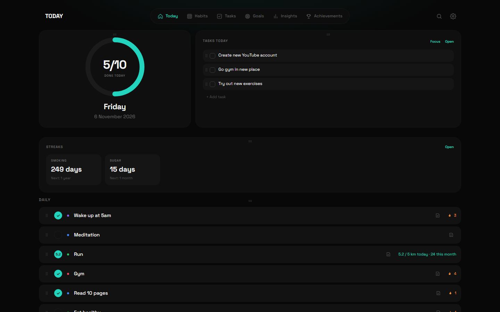
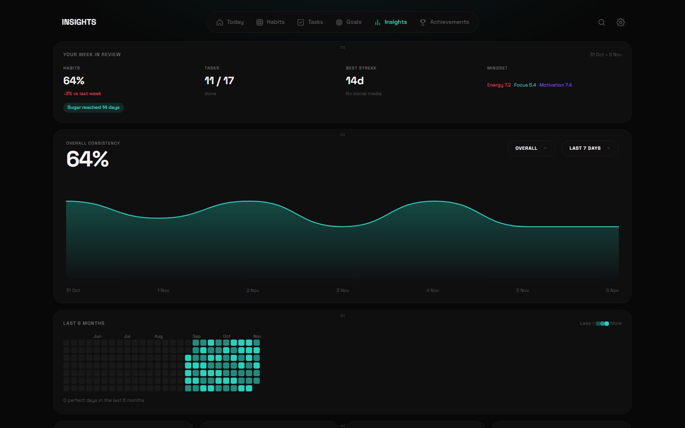

<div align="center">

<p>
<picture>
  <source media="(prefers-color-scheme: light)" srcset="assets/readme/today-light.png">
  
</picture>
</p>

<a href="https://github.com/English-Muffin/Free-Habit-Tracker/releases/latest"></a>
<a href="https://github.com/English-Muffin/Free-Habit-Tracker/releases"></a>
<a href="https://github.com/English-Muffin/Free-Habit-Tracker/actions/workflows/build.yml"></a>
<a href="https://github.com/English-Muffin/Free-Habit-Tracker/actions/workflows/test.yml"></a>
<a href="LICENSE"></a>

**[Download for Windows](https://github.com/English-Muffin/Free-Habit-Tracker/releases/latest)** ·
**[macOS](https://github.com/English-Muffin/Free-Habit-Tracker/releases/latest)** ·
**[Android](https://github.com/English-Muffin/Free-Habit-Tracker/releases/latest)**

[Changelog](CHANGELOG.md) · [Contributing](CONTRIBUTING.md) · [Security](SECURITY.md)

</div>

## Why Daybook

Most habit trackers want an account, a subscription and your data on their servers. Daybook is one
offline app that keeps everything on your device: daily, weekly and monthly habits, a weekly task
planner, goals, quit streaks and the insights that tie them together.

No account, no subscription, no ads, no tracking. Back it up to a file, or point the desktop app at
a Google Drive, OneDrive or Dropbox folder and it syncs between your computers.

## Features

**Habits**

- Daily, weekly and monthly habits on a month grid, with streaks, best streaks and completion rates
  that stay visible while you scroll.
- Track each habit the way it works: done or not, a count (8 glasses of water), or an amount with a
  unit and an optional goal (5 km run, 30 pages, 2 hours).
- Days per week for habits you don't do every day ("gym 3 times a week").
- A short note per day ("new PR on squats"), and a smooth trend line over the month.

**Tasks**

- A week of task columns with a progress ring per day and a mindset tracker (energy, focus, motivation).
- Repeating tasks: every day, every weekday, weekly or monthly, until the end of the month or year.
- Unfinished tasks on past days are marked missed, and one tap fixes it if you just forgot.
- A focus timer for any of today's tasks.

**Goals and achievements**

- Goals with a progress slider across ten life areas.
- Quit streaks for things you've stopped ("smoking: 249 days"), with milestones and your best run.

**Insights**

- Overall consistency over 7, 14 or 30 days, a six-month heatmap, a weekly review, leaderboards and
  top streaks, plus a monthly reflection.

**Make it yours**

- Dark, AMOLED and light themes, any accent colour (presets, picker, hex or RGB).
- Drag tasks, habits, goals and whole cards into the order you like (press and hold on touch screens).
- Switch optional parts on and off in Settings → Features. Undo after every delete.
- Search across tasks, notes, reflections, goals, habits and streaks.

**Your data**

- Everything is stored on the device. Export a full backup (JSON) or a spreadsheet (CSV) any time.
- Desktop: save to a folder you choose, so Google Drive, OneDrive or Dropbox can sync it.
- Google Calendar without a Google login: read events from your calendar's private iCal address
  (desktop) and export tasks as an `.ics` file to import (all versions).
- An optional PIN lock that hides your data on screen.

**Desktop and phone**

- Windows (portable `.exe`), macOS (universal for Intel and Apple Silicon) and Android (`.apk`).
- A small always-on-top widget on desktop with today's habits and tasks.
- A daily reminder: a system notification on Android even when the app is closed, and on desktop
  while it's running.

<p align="center">
  
  
</p>
<p align="center">
  
  
  
</p>

## Get it

| | How |
|---|---|
| **Windows** | Download `Daybook-X.Y.Z-Windows-portable.exe` from the [latest release](https://github.com/English-Muffin/Free-Habit-Tracker/releases/latest) and run it. Nothing to install |
| **macOS** | Download `Daybook-X.Y.Z-mac-universal.zip`, unzip it and drag Daybook to Applications |
| **Android** | Download `Daybook-X.Y.Z-Android.apk` on the phone and open it. Installing a newer APK keeps your data |
| **Any browser** | Open `www/index.html`, or host the `www` folder on any HTTPS static host and install it as an app |

> [!NOTE]
> The builds are not code-signed yet. Windows SmartScreen may say "unknown publisher": choose
> **More info**, then **Run anyway**. macOS will say the app "cannot be verified": right-click
> Daybook and choose **Open** (on macOS 15+, try once, then **System Settings → Privacy & Security →
> Open Anyway**). On Android, allow "install unknown apps" for the app you open the APK with.

## Your data

Daybook keeps one document on the device: habits, ticks, amounts, notes, tasks, goals, streaks and
your monthly reflections. Nothing is sent anywhere.

| Where | What |
|---|---|
| App storage | The data itself (browser `localStorage`, or the app's own storage on desktop and Android) |
| `daybook.json` in your data folder | Desktop only, when you choose a folder. Written on every change; read again when you return to the app |
| `daybook-replaced-<time>.json` | A copy of a save you chose to replace when picking a folder |

Backups are plain JSON and can be imported on any device. Imported data is checked field by field
before it's used.

## Build it yourself

The app is a single file, [`www/index.html`](www/index.html), with no build step and no runtime
dependencies. Electron wraps it for Windows and macOS, Capacitor for Android.

```bash
git clone https://github.com/English-Muffin/Free-Habit-Tracker
cd Free-Habit-Tracker
python -m http.server 8765 --directory www   # then open http://localhost:8765
```

| Build | Command |
|---|---|
| Windows portable `.exe` | `npm install && npm run dist:win` (output in `dist/`) |
| macOS universal `.zip` | `npm install && npm run dist:mac` (on a Mac) |
| Android `.apk` | `npm install && npx cap add android && npx cap sync android`, then build in Android Studio |
| All three, in the cloud | Push a tag like `v1.3.0`: [GitHub Actions](.github/workflows/build.yml) builds them and attaches them to a release |

### Tests

```bash
pip install playwright && playwright install chromium
python tests/smoke.py            # 60+ checks in a desktop and a phone-sized browser
python tests/electron_folder.py  # the desktop app: data folder, widget, app lock (needs npm install)
python tests/stress.py out/      # heavy data, 320 to 1920 px, three themes, layout and overlap checks
```

## How Daybook is built

Daybook is developed with [Claude Code](https://claude.com/claude-code), Anthropic's coding agent.
Most of the code, tests and documentation are drafted in Claude Code sessions, and the repository
carries a [`CLAUDE.md`](CLAUDE.md) with the project context those sessions start from. What goes in,
what gets released, and testing on real devices are the maintainer's call. The app itself doesn't
use any AI service.

## Contributing

Bug reports and ideas are welcome in [Issues](https://github.com/English-Muffin/Free-Habit-Tracker/issues).
Pull requests too: start with [CONTRIBUTING.md](CONTRIBUTING.md). Found a security problem? Please
follow [SECURITY.md](SECURITY.md) instead of opening a public issue.

## License

Daybook is released under the [MIT License](LICENSE). The Space Grotesk font is loaded from Google
Fonts under the SIL Open Font License.
