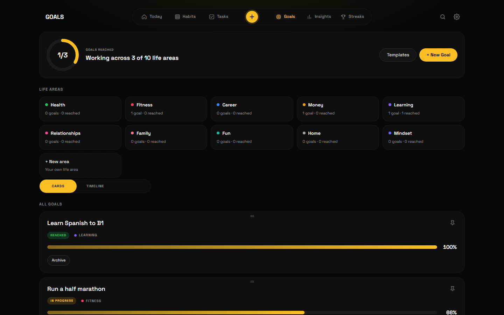
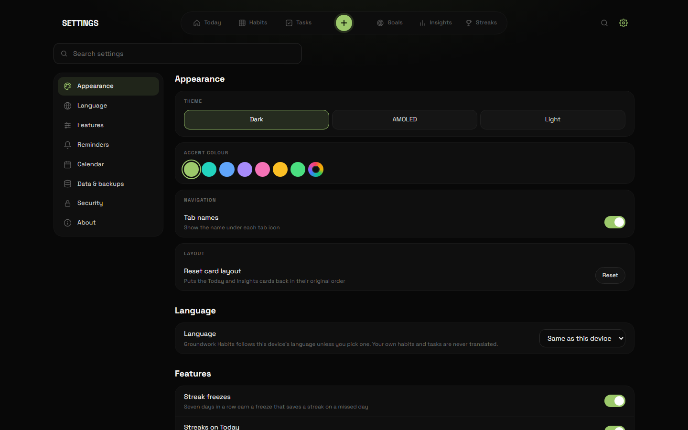

<div align="center">


# Groundwork Habits

<p>

</p>

<a href="https://github.com/English-Muffin/GroundworkHabits/releases/latest"></a>
<a href="https://github.com/English-Muffin/GroundworkHabits/releases/latest"></a>
<a href="https://github.com/English-Muffin/GroundworkHabits/actions/workflows/build.yml"></a>
<a href="https://github.com/English-Muffin/GroundworkHabits/actions/workflows/test.yml"></a>
<a href="LICENSE"></a>

**[Download for Windows](https://github.com/English-Muffin/GroundworkHabits/releases/latest)** ·
**[macOS](https://github.com/English-Muffin/GroundworkHabits/releases/latest)** ·
**[Android](https://github.com/English-Muffin/GroundworkHabits/releases/latest)**

[Changelog](CHANGELOG.md) · [Contributing](CONTRIBUTING.md) · [Security](SECURITY.md)

</div>

## Why Groundwork Habits

Most habit trackers want an account, a subscription and your data on their servers. Groundwork Habits is one
offline app that keeps everything on your devices: daily, weekly and monthly habits, a weekly task
planner, measurable goals, quit streaks and the insights that tie them together.

No account, no subscription, no ads, no tracking. Back it up automatically, or point it at a synced
folder and it follows you between your computers and your phone.

## Features

**Habits**

- Daily, weekly and monthly habits on a month grid, with streaks, best streaks and completion rates.
- Track each habit the way it works: done or not, a count (8 glasses of water), or an amount with a
  unit and an optional goal (5 km run, 30 pages, 2 hours). Days per week for habits you don't do daily.
- **Streak freezes:** seven days in a row earn a freeze that saves your streak on a missed day.
  Switch them off or change the rules per habit.
- **Reminders per habit:** a quiet Yes or No notification, or an alarm. On Android you answer from the
  notification without opening the app.

**Tasks**

- A week of task columns with a progress ring per day and a mindset tracker (energy, focus, motivation).
- Repeating tasks, reminders on any task, a focus timer, and missed tasks marked with a red X.
- Google Calendar events (no Google login) show up as tasks, including repeating events, in your time zone.

**Goals**

<p align="center">
  
</p>

- Measure a goal the way it works: an **amount** towards a target (€ saved, km run), **from → to**
  (weight 85 → 78 kg, debt down to €0), the number of times a **habit** is done, **steps**, or **tasks**
  that show up on their day.
- Ideas to start from in every life area, your own life areas, deadlines with a reminder, automatic
  contributions (€500 every month), a history line, pinning and archiving.

**Insights and achievements**

- Consistency over 7, 14 or 30 days, a heatmap that fits your screen (or 3, 6 or 12 months), a weekly
  review, leaderboards, top streaks and a monthly reflection. Every card can be dragged into place.
- A Streaks tab for things you've stopped ("smoking: 249 days"), with milestones and your best run.

**Make it yours**

<p align="center">
  
  
</p>

- Dark, AMOLED and light themes and any accent colour: moss green by default, presets, or your own from the built-in
  picker (hue, saturation, lightness or a hex code). Habits and life areas get the same picker.
- **11 languages:** English, Portuguese, Spanish, French, German, Italian, Dutch, Polish, Russian,
  Chinese and Japanese. Groundwork Habits follows your device, or pick one in Settings.
- Drag tasks, habits, goals and cards into any order. Quick add (+) from anywhere. Undo for the last
  20 deletes (Ctrl+Z on desktop). Search across everything.
- A Settings page with search, a short description on every option and a link to each section.

**Your data stays yours**

- Everything is saved on your devices. Automatic backups (daily, weekly or monthly), export to JSON or
  a spreadsheet, and import on any device.
- A data folder on desktop and Android: choose a Google Drive, OneDrive, Dropbox or other synced folder
  to keep devices in step.
- **PIN lock with encryption:** with a PIN, your data, backups and exports are encrypted (AES-GCM).
  Fingerprint unlock on Android.

**Desktop and phone**

- Windows (portable `.exe`), macOS (universal for Intel and Apple Silicon), Android (`.apk`) and any browser.
- An always-on-top mini widget on desktop, and a home-screen widget on Android to tick today's habits.

<p align="center">
  
  
  
  
  
</p>
<p align="center">
  
  
</p>

## Get it

| | How |
|---|---|
| **Windows** | Download `Groundwork-Habits-X.Y.Z-Windows-setup.exe` from the [latest release](https://github.com/English-Muffin/GroundworkHabits/releases/latest) and run it. Its own installer lets you pick the folder (or make a new one), shows the space needed and progress, needs no admin rights, and puts the old version back if an update fails. The uninstaller asks whether to keep or erase your data. The app opens in under a second. Prefer no install? `…-Windows-portable.exe` runs from anywhere but unpacks itself on every start, so it takes 10 seconds or more to open |
| **macOS** | Download `Groundwork-Habits-X.Y.Z-mac-universal.zip`, unzip it and drag Groundwork Habits to Applications |
| **Android** | Download `Groundwork-Habits-X.Y.Z-Android.apk` on the phone and open it. Updates install over it and keep your data |
| **Any browser** | Open `www/index.html`, or host the `www` folder on any HTTPS static host and install it as an app |

> [!NOTE]
> The Android APK is signed. The desktop builds are not code-signed yet. Windows SmartScreen may say "unknown publisher": choose
> **More info**, then **Run anyway**. macOS will say the app "cannot be verified": right-click
> Groundwork Habits and choose **Open** (on macOS 15+, try once, then **System Settings → Privacy & Security →
> Open Anyway**). On Android, allow "install unknown apps" for the app you open the APK with.

## Your data

Groundwork Habits keeps one document on each device: habits, ticks, amounts, notes, tasks, goals, streaks and
your monthly reflections. Nothing is sent anywhere unless you choose a folder, a backup or a calendar.

| Where | What |
|---|---|
| App storage | The data itself. With a PIN it is encrypted with a key made from your PIN |
| `groundwork.json` in your data folder (the name from before the rename, so existing folders keep working) | Desktop and Android, when you choose a folder. Written on every change, read when you come back |
| `backups/groundwork-backup-<date>.json` | Automatic backups, the newest 8 kept (encrypted when a PIN is set) |
| `groundwork-replaced-<time>.json` | A copy of a save you chose to replace when picking a folder (desktop) |

Backups can be imported on any device; encrypted ones ask for the PIN. Imported data is checked field by
field before it's used.

## Build it yourself

The app is [`www/index.html`](www/index.html), [`app.css`](www/app.css) and the scripts in
[`www/js`](www/js) (plain files loaded in order, sharing one scope), with no build step and no runtime dependencies. Electron wraps it for Windows and macOS, Capacitor for Android.

```bash
git clone https://github.com/English-Muffin/GroundworkHabits
cd GroundworkHabits
python -m http.server 8765 --directory www   # then open http://localhost:8765
```

| Build | Command |
|---|---|
| Windows portable `.exe` | `npm install && npm run dist:win` (output in `dist/`) |
| macOS universal `.zip` | `npm install && npm run dist:mac` (on a Mac) |
| Android `.apk` | `npm install && npx cap add android && npx cap sync android`, then build in Android Studio |
| All three, in the cloud | Push a tag like `v1.6.1`: [GitHub Actions](.github/workflows/build.yml) builds them and attaches them to a release |

### Tests

```bash
pip install playwright && playwright install chromium
python tests/smoke.py            # 120+ checks in a desktop and a phone-sized browser
python tests/visual.py           # screenshot comparison of 13 screens, light and dark
python tests/electron_folder.py  # the desktop app: data folder, backups, widget, app lock (needs npm install)
python tests/stress.py out/      # heavy data, 320 to 1920 px, three themes, layout and overlap checks
python tests/device_android.py   # a real Android build on a BlueStacks instance named "Groundwork Habits testing"
```

## How Groundwork Habits is built

Groundwork Habits is developed with [Claude Code](https://claude.com/claude-code), Anthropic's coding agent.
Most of the code, tests and documentation are drafted in Claude Code sessions, and the repository
carries a [`CLAUDE.md`](CLAUDE.md) with the project context those sessions start from. What goes in,
what gets released, and testing on real devices are the maintainer's call. The app itself doesn't
use any AI service.

## Contributing

Bug reports and ideas are welcome in [Issues](https://github.com/English-Muffin/GroundworkHabits/issues).
Pull requests too: start with [CONTRIBUTING.md](CONTRIBUTING.md). Found a security problem? Please
follow [SECURITY.md](SECURITY.md) instead of opening a public issue.

## License

Groundwork Habits is free and open-source software under the [GNU Affero General Public License v3.0 or later](LICENSE)
(AGPL-3.0-or-later). You may use, study, share and change it; if you distribute a changed version, or run one
as a service for others, you must share its source under the same licence. The bundled Space Grotesk font is
under the SIL Open Font License (`www/fonts/OFL.txt`).
